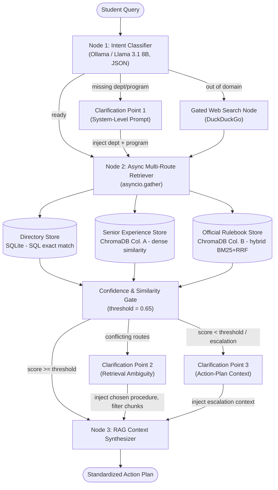

# Campus Grievance-Redressal Assistant

A LangGraph-orchestrated RAG assistant that helps students navigate
academic/administrative edge cases (attendance waivers, grade appeals,
hostel issues, unresponsive advisors, escalation paths) by combining:

- **Official policy** (rulebooks, ordinances) via hybrid search
- **Crowdsourced senior experience** (what actually works in practice) via
  dense semantic search
- **Structured contacts** (who to email, which office, which hours) via
  deterministic SQL

...and asks at most one clarifying question per turn, at exactly the point
in the pipeline where the missing information actually matters -- then
**resumes execution from that exact point** instead of restarting the
whole pipeline.

## Humraah browser MVP

From the repository root, run these commands with Python 3.11 or later:

```bash
cd campus-redressal-assistant/campus-redressal-assistant
python -m venv .venv
. .venv/bin/activate
python -m pip install -r requirements-web.txt
python scripts/run_web.py
```

Open **http://127.0.0.1:8000**. The default web run uses the existing
LangGraph workflow, local ChromaDB and SQLite, and the deterministic mock
model. It builds its indexes at startup without an API key or Ollama.

- **Campus sources** covers supplementary exams, grade reviews, attendance
  questions and advisor follow-ups. It links to IIT Kharagpur's handbook and
  published guidance. Some grade rules apply only to admissions through
  2023, as the citations indicate. Confirm current deadlines and cohort
  rules with the institute. Verified peer accounts are still pending.
- **Sample mode** uses the repository's fictional policy, peer and directory
  records. To try a source discrepancy, ask about an attendance waiver,
  then pick Computer Science and Engineering and UG 4-Year B.Tech.
- The web flow resumes each follow-up on the same LangGraph thread. It keeps
  pending answers in memory for up to 20 minutes and clears completed
  threads. Keep the server at one worker for the MVP. The browser restricts
  lookup to the selected source mode.

The tests in `tests/test_web_mvp.py` verify expected answers, citations,
clarification choices and fallback behavior through the browser API. They use
separate queries from the indexed source documents. Run them alongside the
original graph checks with `python -m pytest -q` after installing
`requirements-web.txt` and `pytest`. The 16-query CLI eval remains available
through `scripts/evaluate.py`.

## Why this exists

Most "RAG chatbot" demos retrieve-then-generate in one shot. Real
grievance redressal usually needs a bit of dialogue: *which department are
you in? which of these two procedures did you mean? have you already
tried the standard channel?* This project is a worked example of building
that multi-turn behavior properly with **LangGraph's `interrupt()` /
`Command(resume=...)`**, rather than re-running the LLM classification
step on every turn.

## Architecture



### The state-injection / forward-transition mechanism

Each clarification checkpoint is a LangGraph node that calls
[`interrupt()`](https://langchain-ai.github.io/langgraph/concepts/human_in_the_loop/).
This pauses the graph *inside that node* and hands a structured payload
(the question + options) back to the caller. The caller resumes later with
`Command(resume=<answer>)` on the **same `thread_id`**; the checkpointer
replays up to the interrupted node, injects the answer directly into
state, and the graph's own edges send execution straight to the next
required node:

| Checkpoint | Triggered by | Resumes directly into |
|---|---|---|
| **Point 1** -- missing entity | Department/program missing | Node 2 (Retriever) -- **skips re-running Node 1** |
| **Point 2** -- retrieval ambiguity | \>=2 competing procedures score near the top | Node 3 (Synthesizer), with irrelevant chunks filtered out |
| **Point 3** -- action-plan context | Escalation-type query, or low confidence | Node 3 (Synthesizer), picking the right escalation branch |

No LLM call is wasted re-classifying what the user already said. See
`src/nodes/clarification.py` and `src/graph.py` for the actual wiring, and
`tests/test_graph_smoke.py` for all three checkpoints exercised end to end.

### Two deliberate refinements over a literal reading of the spec

While implementing the confidence gate (`src/nodes/confidence_gate.py`),
two issues showed up that are worth calling out (and are exactly the kind
of thing worth mentioning if asked about this project):

1. **RRF fusion score != confidence score.** Reciprocal Rank Fusion is a
   *ranking* signal (`1/(k+rank)`), not a calibrated similarity magnitude
   -- across a handful of documents, rank 5's fused score is barely lower
   than rank 1's, so using it directly as "confidence" made the gate think
   nearly everything was equally relevant. Fixed by scoring confidence off
   the actual dense cosine similarity / normalized BM25 magnitude for each
   chunk, while still using RRF to decide the retrieval order.
2. **Directory presence isn't confidence.** A department contact is
   available for almost every query once the department is known, so
   counting it toward the confidence score made the gate pass on
   department alone. Directory results now only populate the final
   answer's "Points of Contact" section, not the routing decision.

## Tech stack

| Layer | Technology |
|---|---|
| Workflow orchestration | **LangGraph** (Python), `interrupt()` / `Command` for HITL |
| LLM runtime | **Ollama**, local Llama 3.1 8B or Qwen 2.5 7B/14B, JSON-constrained |
| Embeddings | **BAAI/bge-large-en-v1.5** (`sentence-transformers`) |
| Vector DB | **ChromaDB** (embedded, persistent, two collections) |
| Relational DB | **SQLite** (directory/contacts) |
| Hybrid search | **BM25** (`rank_bm25`) fused with dense vectors via **RRF** |
| Web fallback | **DuckDuckGo Search** (gated, no API key) |
| Async execution | `asyncio.gather()` across all three stores |

## Repository layout

```
campus-redressal-assistant/
├── app.py                       # Interactive CLI demo
├── scripts/ingest_data.py       # Builds SQLite + both Chroma collections
├── data/                        # Sample/placeholder data -- replace with real data
│   ├── faculty_directory.csv
│   ├── student_reps.csv
│   ├── senior_experiences.json
│   └── rulebook_chunks.json
├── src/
│   ├── config.py                # Env-driven settings, mock/production switches
│   ├── state.py                 # RedressalState (the LangGraph state schema)
│   ├── llm.py                   # MockLLM / OllamaLLM (Node 1 + Node 3)
│   ├── embeddings.py            # Hashing (dev) / bge-large-en-v1.5 (prod) embedder
│   ├── graph.py                 # StateGraph assembly + all conditional edges
│   ├── stores/
│   │   ├── directory_store.py         # SQLite, SQL exact match
│   │   ├── senior_experience_store.py # ChromaDB Col. A, dense similarity
│   │   ├── rulebook_store.py          # ChromaDB Col. B, hybrid BM25+RRF
│   │   └── chroma_client.py           # Shared thread-safe Chroma client
│   └── nodes/
│       ├── intent_classifier.py       # Node 1
│       ├── retriever.py               # Node 2 (asyncio.gather)
│       ├── confidence_gate.py         # Threshold + ambiguity + escalation logic
│       ├── clarification.py           # The three interrupt() checkpoints
│       ├── web_search.py              # Gated fallback
│       └── synthesizer.py             # Node 3, standardized markdown output
└── tests/test_graph_smoke.py    # End-to-end tests, all fully offline
```

## Quick start (mock mode -- no GPU, no Ollama, fully offline)

Mock mode swaps the LLM and embedding calls for deterministic, dependency-light
stand-ins so you can inspect and demo the **graph wiring itself** immediately.

```bash
git clone <your-repo-url>
cd campus-redressal-assistant
python3 -m venv .venv
source .venv/bin/activate        # Windows: .venv\Scripts\activate
pip install -r requirements.txt

cp .env.example .env             # defaults already set to mock mode

python scripts/ingest_data.py    # builds ./data/directory.db and ./data/chroma
python app.py                    # interactive CLI
```

Try asking:
- `My advisor is ignoring my attendance waiver request.` -> Clarification Point 1
- `How do I apply for a grade review in Computer Science and Engineering?` -> Clarification Point 2
- `My FA is unresponsive, should I go to the HOD? Mechanical Engineering, UG 4-year` -> Clarification Point 3

Run the automated tests:

```bash
pytest -q
```

## Switching to production mode (real local model + real embeddings)

1. **Install Ollama** and pull a model:
   ```bash
   ollama pull llama3.1:8b        # or: ollama pull qwen2.5:14b
   ```
2. **Install the production extras** (already in `requirements.txt`):
   `sentence-transformers` will download `BAAI/bge-large-en-v1.5` from
   HuggingFace on first use (~1.3GB).
3. **Edit `.env`**:
   ```dotenv
   LLM_BACKEND=ollama
   EMBEDDING_BACKEND=sentence-transformers
   WEB_SEARCH_BACKEND=duckduckgo
   ```
4. **Re-ingest** (embeddings differ from mock mode, so the vector store
   must be rebuilt):
   ```bash
   rm -rf data/chroma
   python scripts/ingest_data.py
   ```
5. Replace the placeholder data in `data/*.csv` and `data/*.json` with your
   own institute's faculty directory, crowdsourced senior insights, and
   rulebook chunks (the schemas are documented at the top of each
   `src/stores/*.py` file).

## Loading your own data

The `data/` files are placeholders. Replacing them depends on what format
your raw data is already in:

**Directory (faculty/HOD/reps):** Enter it directly into
`data/faculty_directory.csv` / `data/student_reps.csv` (plain CSV, schema
documented in `src/stores/directory_store.py`). This store only needs a
short list -- HOD + Faculty Advisor + one student rep per department --
so manual entry is usually faster and more reliable than scraping.
**We deliberately did not build a scraper for an institute website here**:
many institute homepages disallow automated access via `robots.txt`, and
department subdomains vary wildly in structure and reliability. Check your
own institute's `robots.txt` and terms of use before scraping anything,
and prefer an official data export or API if one exists.

**Senior-experience data (Google Form export, Excel/Sheets, or CSV):**
```bash
python scripts/convert_senior_experiences.py --input path/to/export.xlsx
```
Walks you through mapping your sheet's columns to the schema
(`category`/`subcategory`/`department`/`degree_program`/`summary`) and can
auto-tag `subcategory` from free-text answers using the same keyword rules
Node 1 uses, flagging anything it can't confidently tag as `unclassified`
for manual review.

**Rulebooks (PDF / Word docs):**
```bash
python scripts/chunk_rulebooks.py --input data/raw_rulebooks
```
Organize source files into department subfolders (`data/raw_rulebooks/Civil
Engineering/ordinance.pdf`); anything directly in the root is tagged
`department: General` and matches every department at query time. Splits on
numbered clause/section markers where present, falls back to ~120-word
overlapping chunks otherwise, and auto-tags `subcategory` the same way.

After either conversion, rebuild the stores:
```bash
rm -rf data/chroma data/directory.db
python scripts/ingest_data.py
```

## Evaluation

`eval/test_queries.json` is a labeled set of test queries (expected
department, subcategory, routing decision, gate decision, top retrieved
tag, and whether the query should trigger the escalation checkpoint).
`scripts/evaluate.py` runs every case through the graph (scripting any
clarification answers via `Command(resume=...)`) and reports:

- **Intent / routing / gate accuracy** against the labels
- **Retrieval accuracy** -- does the single highest-scoring retrieved chunk
  carry the expected tag?
- **Escalation precision/recall** -- for queries labeled as needing
  Clarification Point 3, how many triggered it; for queries that
  shouldn't, how many falsely did?
- **Groundedness** (structural, mock-mode) -- every chunk the synthesizer
  chose to show must appear verbatim in the final answer

```bash
python scripts/evaluate.py
```

writes `eval/results.csv` and `eval/failures.json`. Note: **"action-plan
relevance" is deliberately not auto-scored** -- whether the actual steps
are the *right* steps is a judgment call, so `results.csv` includes a
blank `human_rating_action_plan_1to5` column for a human (or an
LLM-as-judge call you wire in yourself) to fill in against a rubric.

Running this against the sample dataset (mock mode) surfaces two genuine,
reproducible failure modes worth knowing about before you present numbers
from it:

1. **Keyword-regex brittleness to paraphrasing** -- `MockLLM`'s intent
   classifier is regex-based (see `INTENT_RULES` in `src/llm.py`), so
   phrasing outside the exact keyword list (e.g. "isn't responding"
   instead of "unresponsive") misses. This is mock-mode-specific --
   `LLM_BACKEND=ollama` replaces this with real semantic understanding.
2. **A length/keyword-density bias in mock-mode hybrid retrieval** -- one
   sample rulebook clause tends to rank #1 across unrelated queries,
   likely because the hashing embedder isn't semantic and that clause is
   longer/keyword-denser than the others. Worth re-running this same eval
   with `EMBEDDING_BACKEND=sentence-transformers` to see if it persists.

## Known limitations (read before treating this as production-ready)

- **Sample data is placeholder/fictitious** -- names, emails and clauses in
  `data/` exist only to exercise the pipeline end to end.
- **Mock-mode retrieval quality is not semantically meaningful.** The
  hashing embedder used in mock mode is there to test wiring and routing
  logic offline, not to produce good rankings -- expect noisier
  confidence scores and occasional odd top-1 picks until you switch to
  `sentence-transformers` + a real corpus.
- **Ambiguity/escalation thresholds are hand-tuned constants**
  (`_AMBIGUITY_MARGIN`, `_MIN_SCORE_FOR_AMBIGUITY`, `CONFIDENCE_THRESHOLD`)
  against a 5-14 document sample corpus -- revisit them once real data and
  real embeddings are in place.
- **Checkpointing defaults to in-memory** (`MemorySaver`); use
  `build_persistent_graph()` in `src/graph.py` (backed by SQLite via
  `langgraph-checkpoint-sqlite`) if you need clarifications to survive a
  process restart.
